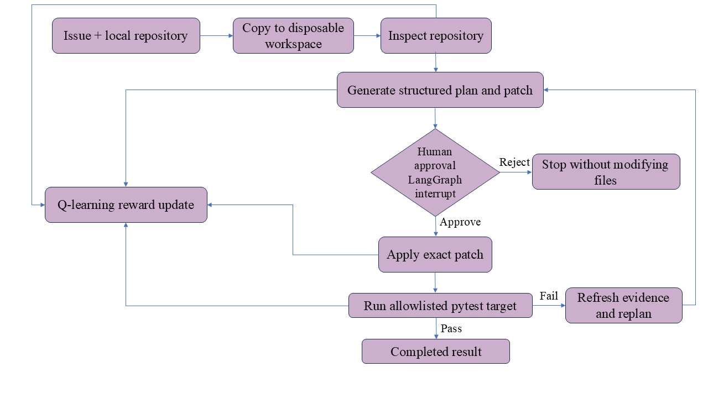

# Adaptive Repository Agent

A portfolio project that combines **LangGraph**, **LangChain**, and **agentic reinforcement learning** to solve narrowly scoped repository maintenance tasks. Given a local checkout and an Issue-style task description, the agent inspects evidence, proposes an exact patch, pauses for human approval, applies the patch in an isolated copy, and runs an allowlisted pytest target.

> The Q-learning policy optimizes **workflow routing**. It does not train or fine-tune the language model.

## Why this exists

Many coding-agent demos stop at chat or a textual plan. This project makes the
engineering loop visible and testable:

- explicit LangGraph state, conditional routing, retries, and checkpointed approval;
- LangChain tools and structured LLM output for repository inspection and patch proposals;
- a small, inspectable Q-learning policy that learns routing choices from reward;
- a human approval gate before any write;
- disposable workspaces, exact text replacements, and allowlisted pytest execution;
- before/after test evidence, patch diffs, event trace, reward, and learned Q-values in Streamlit.

## Architecture

```
flowchart LR\
    A[Issue + local repository] --> B[Copy to disposable workspace]\
    B --> C[Inspect repository]\
    C --> D[Generate structured plan and patch]\
    D --> E{Human approval\nLangGraph interrupt}\
    E -->|Reject| X[Stop without modifying files]\
    E -->|Approve| F[Apply exact patch]\
    F --> G[Run allowlisted pytest target]\
    G -->|Pass| H[Completed result]\
    G -->|Fail| I[Refresh evidence and replan]\
    I --> D\
    C --> J[Q-learning reward update]\
    D --> J\
    F --> J\
    G --> J\
```



The full design, state model, reward signal, and safety boundary are documented in [docs/architecture.md](docs/architecture.md).

## Features

| Area | What it demonstrates |
| --- | --- |
| LangGraph | Typed task state, conditional edges, `interrupt()` approval, checkpointed resume, bounded revision loop |
| LangChain / LLM | Repository-aware structured patch proposals for OpenAI-compatible APIs |
| Agentic RL | Tabular Q-learning chooses the next legal workflow action and records reward/steps |
| Safety | Source repository stays untouched; edits occur only in `.adaptive_agent/runs/<id>` after approval |
| Verification | Only the user-selected pytest path or node selector is executed, never model-generated shell commands |
| UI | Streamlit dashboard with proposal diff, applied diff, test comparison, diagnostics, and policy table |

## Requirements

- Python 3.11 or newer
- [uv](https://docs.astral.sh/uv/) for dependency management
- A local repository that can run pytest for **Local repository** mode
- One API key for OpenAI, DeepSeek, or Qwen only when generating a patch for a real local repository

The built-in benchmark and RL training do not require an LLM key.

## Quick start

```powershell
git clone https://github.com/<your-github-username>/adaptive-repository-agent.git
cd adaptive-repository-agent
uv sync --all-groups
Copy-Item .streamlit\secrets.toml.example .streamlit\secrets.toml
uv run streamlit run app.py
```

Open the local URL printed by Streamlit, normally `http://localhost:8501`.

### Configure an LLM provider

Edit the local-only file `.streamlit/secrets.toml`. It is ignored by Git, so no
key should be committed. Leave unused provider fields blank.

```toml
LLM_PROVIDER = "deepseek" # openai, deepseek, or qwen

# OpenAI
OPENAI_API_KEY = ""
OPENAI_MODEL = "gpt-4.1-mini"
OPENAI_BASE_URL = "https://api.openai.com/v1"

# DeepSeek
DEEPSEEK_API_KEY = "your-deepseek-key"
DEEPSEEK_MODEL = "deepseek-chat"
DEEPSEEK_BASE_URL = "https://api.deepseek.com/v1"

# Qwen / DashScope
QWEN_API_KEY = ""
QWEN_MODEL = "qwen-plus"
QWEN_BASE_URL = "https://dashscope.aliyuncs.com/compatible-mode/v1"
```

You may instead configure the same names as environment variables. For example:

```powershell
$env:LLM_PROVIDER = "openai"
$env:OPENAI_API_KEY = "your-key"
$env:OPENAI_MODEL = "gpt-4.1-mini"
uv run streamlit run app.py
```

## Run a local-repository task

In the **Local repository** sidebar, enter:

1. **Repository path**: the absolute path of a pytest-ready checkout.
2. **Issue or task**: a concrete expected behavior and scope.
3. **Search term**: optionally, a function name, class name, or error text.
4. **Pytest target**: a relative path or node selector, such as `tests/test_api.py::test_login`.
5. Click **Run Agent**, inspect the proposed diff, then click **Approve patch**.

Example task used during validation (point the path at your own local checkout):

```text
Repository path: C:\path\to\order-pricing-demo
Issue: Fix the free-shipping boundary in shipping_fee. Orders with a subtotal of
exactly 50.0 must receive free shipping. Keep the 5.0 fee below 50.0. Update
source code only; the supplied regression test must remain unchanged.
Search term: shipping_fee
Pytest target: tests/test_shipping.py::test_orders_at_exactly_fifty_dollars_get_free_shipping
```

Expected patch:

```diff
-    if order_total > 50:
+    if order_total >= 50:
```

The original repository is never changed. Review the **Applied exact file changes** section and the **Before patch / After patch** test comparison in the dashboard to inspect the run.

## Built-in benchmark and RL training

The project ships a small calculator fixture with two known regressions:

- reject division by zero with `ValueError`;
- preserve decimal precision when calculating an average.

Choose **Benchmark demo** to inspect the end-to-end LangGraph workflow without a repository path or LLM key. The **RL training** tab runs repeated, isolated benchmark episodes and updates the persisted Q-table. Training uses fast patch validation to make exploration practical; an interactive task run still executes the real selected pytest target.

Terminal equivalents:

```powershell
uv run adaptive-repository-agent train --episodes 160
uv run adaptive-repository-agent run division-by-zero
uv run adaptive-repository-agent policy
```

For a real repository from the terminal:

```powershell
uv run adaptive-repository-agent run-custom `
  "C:\projects\your-repository" `
  "Fix the login bug described in the Issue" `
  --search-term "login" `
  --test-target "tests/test_api.py::test_login"
```

Add `--auto-approve` only for a disposable repository. The dashboard keeps the approval gate on by default.

## Safety model and limitations

- The source checkout is copied to `.adaptive_agent/runs/<id>` before inspection.
- The agent applies an exact `old_text` to `new_text` replacement only after approval.
- It runs Python's pytest with a user-provided relative target; it does not run LLM-generated commands.
- A failing patch invalidates the proposal, refreshes evidence, and requires approval for a new patch.
- Dependency or test-collection failures stop with diagnostics instead of prompting an unrelated code edit.
- This is an educational, local-first project. It does not yet create GitHub branches, commit changes, or open pull requests.

Do not point the application at a repository containing secrets or rely on it as an unattended production change system. See [SECURITY.md](SECURITY.md) for security reporting and operational guidance.

## Development

```powershell
uv sync --all-groups
uv run pytest -q
uv run ruff check .
uv run python -m compileall -q src app.py
```

The GitHub Actions workflow runs these checks on supported pull requests and pushes. Contribution expectations are in [CONTRIBUTING.md](CONTRIBUTING.md).

## Repository layout

```text
.
├── app.py                       # Streamlit entry point
├── src/adaptive_agent/
│   ├── graph.py                 # LangGraph state machine and safety gates
│   ├── planner.py               # Structured LLM patch planner
│   ├── rl.py                    # Tabular Q-learning routing policy
│   ├── runtime.py               # Shared UI/CLI application service
│   ├── workspace.py             # Disposable workspaces and pytest runner
│   └── dashboard.py             # Streamlit interface
├── fixtures/calculator/         # Isolated benchmark environment
├── tests/                       # Unit and workflow tests
├── docs/architecture.md         # Design and evaluation notes
└── .streamlit/secrets.toml.example
```

## Interview talking points

- Why model generation, workflow orchestration, and RL routing are separate concerns.
- How `interrupt()` makes mutation approval part of the graph contract rather than a UI convention.
- Why an explicit, finite action space makes the Q-policy inspectable and reproducible.
- How baseline and post-patch pytest results distinguish pre-existing failures from regressions introduced by the patch.
- What must change to evolve this from a local evaluator into an Issue-to-draft-PR service.

## License

Released under the [MIT License](LICENSE).
