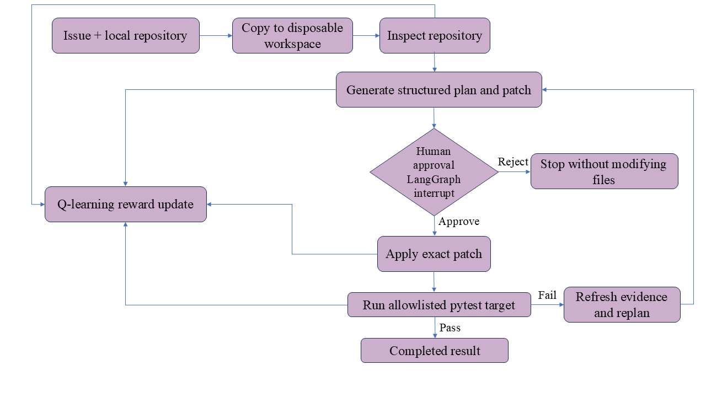

# Architecture and evaluation

## System boundary

Adaptive Repository Agent is a local-first code-maintenance workflow. It accepts an Issue-style task, a local repository path, an optional search term, and a pytest path or node selector. It copies the repository before doing any work; the original checkout remains unchanged.

The project separates three responsibilities deliberately:

| Layer | Responsibility | Not responsible for |
| --- | --- | --- |
| LangChain + LLM | Gather bounded evidence and return a structured patch proposal | Executing arbitrary shell commands |
| LangGraph | Persist state, route nodes, interrupt for approval, retry a failed patch, and stop safely | Deciding a token-level model policy |
| Q-learning | Select the next legal workflow action from a finite state representation | Fine-tuning or replacing the LLM |

## End-to-end workflow

```
flowchart LR\
    A[Issue + local repository] --> B[Copy to disposable workspace]\
    B --> C[Inspect repository]\
    C --> D[Generate structured plan and patch]\
    D --> E{Human approval\nLangGraph interrupt}\
    E -->|Reject| X[Stop without modifying files]\
    E -->|Approve| F[Apply exact patch]\
    F --> G[Run allowlisted pytest target]\
    G -->|Pass| H[Completed result]\
    G -->|Fail| I[Refresh evidence and replan]\
    I --> D\
    C --> J[Q-learning reward update]\
    D --> J\
    F --> J\
    G --> J\
```



The diagram is an end-to-end overview. In the implementation, every executable workflow action feeds its reward into the `learn` node, which updates the Q-table before the policy selects the next legal action. A failing test enters the `revise` action, clears stale planning state, re-inspects the disposable workspace, and then produces a newly approved proposal.

## Workflow state

`AgentState` makes the task lifecycle explicit. Its important groups are:

- task inputs: objective, task kind, source repository, search term, and pytest target;
- repository evidence: disposable workspace, discovered source targets, and context;
- change proposal: plan, exact patches, approval, and application status;
- verification: baseline output, post-patch output, failure identifiers, and test-environment status;
- learning data: action trace, current reward, cumulative reward, failures, and revision count.

The graph can only choose legal actions for the current state. Before context is available it must retrieve. Before a patch is applied it must request approval. After a failed test it must revise rather than re-running the stale patch.

## Human approval and verification

`LangGraph interrupt()` stops the run before mutation and returns both the implementation plan and the exact proposed replacements. Resuming the graph with approval is the only normal path to application.

The patch uses exact `old_text` and `new_text` replacement. An absent or ambiguous old-text match is rejected. The verification process runs Python pytest against the user-supplied relative path or node selector. The language model never supplies a command to execute.

For custom repositories the graph first records a baseline result. After a patch, it compares failure identifiers so the UI can distinguish a new regression from a pre-existing failure in the selected target.

## Agentic RL formulation

The Q-learning policy treats task orchestration as a small Markov decision process.

**Observation**

```text
context | plan | approved | patch | test | failures | revisions
```

Each component is a discretized workflow flag or capped count. The fixed action space is:

```text
retrieve, plan, request_approval, apply_patch, run_test, revise
```

Action masking prevents impossible transitions. For example, `apply_patch` is not legal before approval, and a failed test allows only `revise`. This keeps training reproducible and makes a policy table intelligible during an interview.

The update uses standard tabular Q-learning:

```text
Q(s, a) <- Q(s, a) + alpha * (reward + gamma * max_a' Q(s', a') - Q(s, a))
```

Rewards favor verified completion and penalize redundant retrieval, invalid actions, unnecessary tool steps, timeouts, and test failures. The benchmark uses a deterministic fixture so repeated episodes have stable feedback. This is intentionally agentic RL for workflow decisions, not LLM fine-tuning.

## Evaluation protocol

Use both evidence types when presenting a run:

1. **Benchmark episodes**: train on the calculator fixture and inspect completion rate, reward, steps, and the learned Q-values.
2. **Local repository task**: capture the proposed diff, approval, applied diff, and before/after targeted pytest output.
3. **Safety checks**: verify the source repository was not modified and that a rejected proposal did not change the disposable workspace.
4. **Failure recovery**: use a task whose first proposal fails and verify the graph refreshes context and requests approval for a different patch.

The project does not claim a benchmark score against SWE-bench or production autonomy. It demonstrates a narrow, inspectable orchestration and evaluation surface that can be extended safely.

## Extension path

To build an Issue-to-draft-PR service, add a GitHub adapter outside the current core graph that receives an Issue, creates a branch/worktree, exposes an allowlisted repository interface, and opens a draft pull request only after human approval and passing checks. Any such deployment also needs authentication, rate limits, audit logs, sandboxing, repository access control, and evaluation against a curated Issue set.
